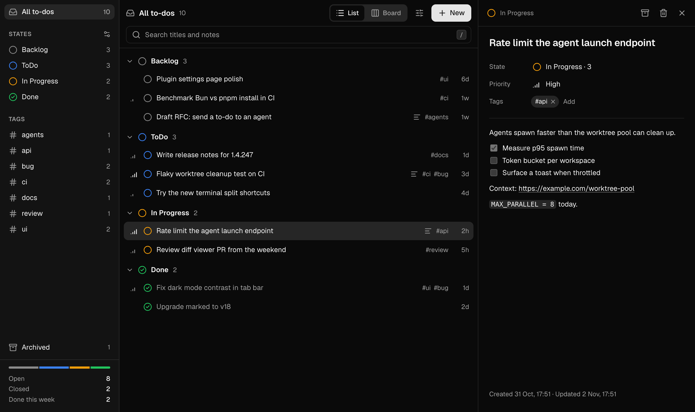
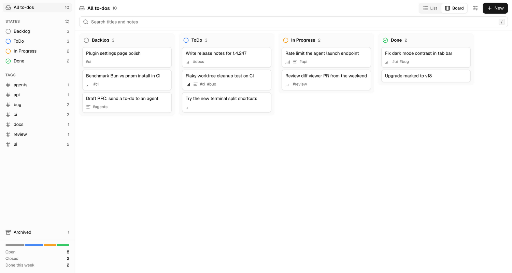
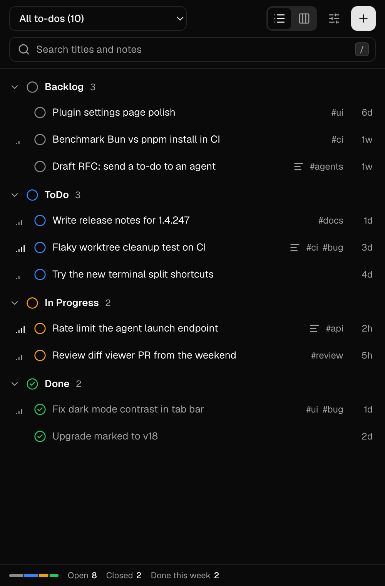

<div align="center">


# ToDos for Orca

**A personal to-do list inside [Orca](https://github.com/stablyai/orca), the agent-orchestrator IDE.**

Keep your next tasks beside your agent sessions. Use a list or a board in the center tab, or a
compact list in the sidebar. No account, no sync service, no network.

[](https://github.com/uttam-gelot/orca-todos/actions/workflows/ci.yml)
[](LICENSE)
[](https://github.com/stablyai/orca)
[](https://bun.sh)
[](https://www.typescriptlang.org/)

<br />



</div>

---

## Contents

- [What is ToDos for Orca?](#what-is-todos-for-orca)
- [Features](#features)
- [Screenshots](#screenshots)
- [Requirements](#requirements)
- [Install in Orca](#install-in-orca)
- [Use the plugin](#use-the-plugin)
- [Data and privacy](#data-and-privacy)
- [Upcoming features](#upcoming-features)
- [Develop](#develop)
- [Contributing](#contributing)
- [License](#license)

## What is ToDos for Orca?

Orca runs many coding agents in parallel. Each agent works in its own git worktree. While the agents
work, you need a place for your own next steps. ToDos for Orca gives you that place inside Orca, so
you do not have to change to a different app.

The plugin has two views of the same to-dos:

- **Center tab.** A full-size view with a navigator, a list or a board, and a details pane.
- **Sidebar panel.** A compact view in the right sidebar, beside your terminals and diffs.

When you change a to-do in one view, the other view shows the change immediately. The plugin uses
the Orca theme, fonts, and control sizes, so it looks like a part of Orca.

## Features

- **States.** Add, rename, recolor, reorder, and delete states. A state that is marked "closed" counts as done.
- **To-dos.** Each to-do has a title, markdown notes, tags, and a priority. You can archive a to-do. You can undo a delete.
- **Links.** Links in notes open in your default browser.
- **List view.** The list shows to-dos in groups, one group for each state.
- **Board view.** The board shows one column for each state. Drag a card to move it to a different state.
- **Navigator.** Show all to-dos, one state, one tag, or the archive. Each item shows a count. The navigator also shows the numbers for the current week.
- **Search and filter.** Search titles and notes. Filter by priority. Sort manually, by priority, by last update, or by creation date.
- **Keyboard.** You can do all tasks with the keyboard. Press `?` to see all shortcuts.
- **Theme.** The plugin uses the Orca theme colors in light mode and in dark mode.

## Screenshots

| Board view (light)                                                                     | Sidebar panel (dark)                                                      |
| -------------------------------------------------------------------------------------- | ------------------------------------------------------------------------- |
|  |  |

## Requirements

- Orca 1.4.246 or later.
- [Bun](https://bun.sh) 1.4 or later, only if you change the code.

## Install in Orca

1. In Orca, open **Settings → Plugins**.
2. Select **Turn on plugins**.
3. Select **Development folders…** and add this folder.
4. Review the plugin permissions, then enable the plugin.

To install a copy instead of a development folder:

1. Run `bun run pack`. This command writes a clean copy to `release/`.
2. In Orca, add the `release/` folder.

Orca does not accept a folder that contains `node_modules` symlinks. The `release/` copy does not contain them.

## Use the plugin

### Open the center tab

Use one of these methods:

- Select **+** in the tab bar, then select **Open ToDos board**.
- Open the command palette, then run **Open ToDos board**.

Orca creates a file named `untitled.todos` and opens the board in it. To give the tab the title **ToDos**, rename the file to `ToDos`. Orca opens the board for each file named `ToDos` or with the `.todos` extension.

The file stays empty. The plugin keeps your to-dos in Orca plugin storage, not in the file.

### Open the sidebar panel

Select the ToDos icon in the right sidebar.

The sidebar panel cannot open the center tab. That action needs the `workspace:write` permission. This plugin asks only for `storage:own`.

### Keyboard shortcuts

The plugin does not use shortcuts with `⌘` or `Ctrl`, except `⌘Z` / `Ctrl+Z` for undo. Orca keeps all its own shortcuts.

| Keys                | Action                                       |
| ------------------- | -------------------------------------------- |
| `J` `K` / `↓` `↑`   | Select the next or previous to-do            |
| `H` `L` / `←` `→`   | Go to the previous or next column (board)    |
| `[` `]`             | Go to the previous or next scope             |
| `N`                 | Add a to-do                                  |
| `/`                 | Search                                       |
| `V`                 | Switch between list and board                |
| `↵`                 | Open details. Press again to edit the title  |
| `E`                 | Edit notes                                   |
| `1`–`9`             | Move the to-do to state 1–9                  |
| `Shift+H` `Shift+L` | Move the to-do to the previous or next state |
| `X`                 | Mark done, or open again                     |
| `P`                 | Change the priority                          |
| `A`                 | Archive, or restore from the archive         |
| `⌫`                 | Delete. Press `⌘Z` / `Ctrl+Z` to undo        |
| `Esc`               | Close, clear, or go back                     |

## Data and privacy

- The plugin keeps all data in Orca plugin storage on your computer.
- The plugin does not use the network. Orca runs the plugin in a sandboxed frame with no network access.
- The plugin asks for one permission: `storage:own`. This permission gives access only to the plugin's own storage.

## Upcoming features

These features are planned. They are not available yet.

- **Due dates.** Give a to-do a date, and see the to-dos that are due soon.
- **Quick-add syntax.** Type tags, a priority, and a state in the title, for example
  `Fix login #auth !high`.
- **Checklists.** Show the progress of a markdown checklist on the row and on the card.
- **Lists for each project.** Keep a separate list for each repository or workspace.
- **Send a to-do to an agent.** Start an Orca agent from a to-do. This feature needs a future Orca
  host API.

Do you want a different feature? [Open an issue](https://github.com/uttam-gelot/orca-todos/issues).

## Develop

### Set up

```sh
bun install
lefthook install
```

`lefthook install` connects the pre-push checks. Do this one time for each clone.

### Commands

| Command                    | Purpose                                             |
| -------------------------- | --------------------------------------------------- |
| `bun run build`            | Bundle `src/` into `dist/app.js` and `dist/app.css` |
| `bun run watch`            | Build again after each change                       |
| `bun test`                 | Run all tests                                       |
| `bun run test:unit`        | Run only the unit tests                             |
| `bun run test:integration` | Run only the integration tests                      |
| `bun run typecheck`        | Check types with TypeScript (strict)                |
| `bun run lint`             | Check the code with ESLint                          |
| `bun run format`           | Format the code with Prettier                       |
| `bun run format:check`     | Check the format, but do not change files           |
| `bun run pack`             | Build and write an installable copy to `release/`   |

GitHub Actions (`.github/workflows/ci.yml`) runs the type check, ESLint, the Prettier check, the tests, a secret scan, and a check that `dist/` matches the source. It runs on each push to `main` and on each pull request.

Before each push, `lefthook` runs a secret scan (gitleaks), the tests, ESLint, and a Prettier check. If one check fails, the push stops.

### Why `dist/` is in the repository

Orca loads `dist/` as it is. A plugin frame has no network access, so Orca cannot build the plugin. After you change the code, run `bun run build` and commit `dist/` with your change.

### Project structure

```text
orca-plugin.json     Plugin manifest: the two views and the storage permission
panel.html           Entry page for the sidebar panel
board.html           Entry page for the center tab
src/
  main.tsx           Starts the app
  App.tsx            Layout, empty states, error states, and messages
  components/        UI components. Each component has its own CSS file
  model.ts           Types and rules: filter, sort, order, counts, data checks
  store.ts           App state, storage, and sync between the two views
  orca.ts            The only access to the Orca frame API
  keys.ts            Keyboard shortcuts
  log.ts             Logger
  errors.ts          Error types
  styles.css         Design tokens and resets
tests/
  setup.ts           Test DOM (happy-dom) and a fake Orca frame
  factories/         Test data builders
  fixtures/          Stored records: valid, old, and not valid
  unit/              Unit tests
  integration/       Tests of the store with storage, and of the full app
dist/                Build output that Orca loads
```

The tests use a fake Orca frame in memory. You do not need Orca to run the tests.

### Tech stack

- [Preact](https://preactjs.com) 11 and [@preact/signals](https://github.com/preactjs/signals)
- TypeScript 6. TypeScript 7 is not used yet, because typescript-eslint does not support it.
- Bun for packages, scripts, the bundle, and tests
- Plain CSS with BEM class names
- [marked](https://marked.js.org) and [DOMPurify](https://github.com/cure53/DOMPurify) for notes
- [Lucide](https://lucide.dev) icons and the [Geist](https://vercel.com/font) font

More details:

- `DESIGN.md` gives the visual rules.
- `PRODUCT.md` gives the users and the purpose.
- `AGENTS.md` gives the instructions for coding agents.

## Contributing

Contributions are welcome: fixes, new features, and better docs.

1. Fork the repository and make a branch, for example `feature/due-dates` or `fix/board-drag`.
2. Follow `AGENTS.md` and the skills in `.agents/skills/`. They give the code, CSS, test, and commit
   rules.
3. Run `bun run build` and commit `dist/` with your change.
4. Open a pull request. CI must pass.

## License

MIT. See [LICENSE](LICENSE).

The plugin includes the Geist font, under the SIL Open Font License. See `dist/OFL.txt`.
