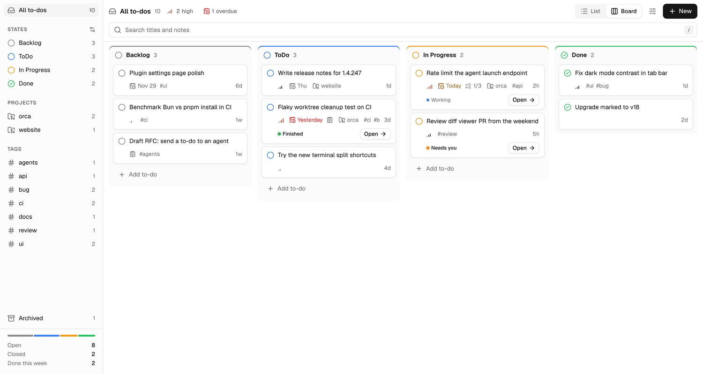
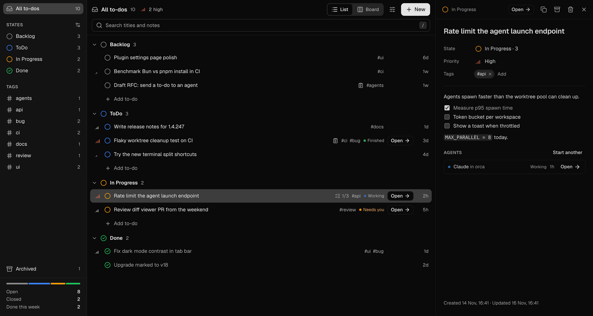
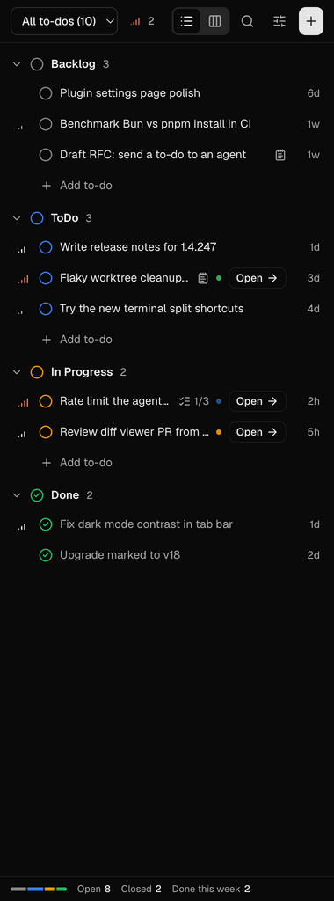

<div align="center">


# ToDos for Orca

**A personal to-do list inside [Orca](https://github.com/stablyai/orca), the agent-orchestrator IDE.**

Keep your next tasks beside your agent sessions. Use a list or a board in the center tab, or a
compact list in the sidebar. No account, no sync service, no network.

[](https://github.com/uttam-gelot/orca-todos/actions/workflows/ci.yml)
[](LICENSE)
[](https://github.com/stablyai/orca)
[](https://bun.sh)
[](https://www.typescriptlang.org/)

<br />

<picture>
  <source media="(prefers-color-scheme: dark)" srcset="docs/screenshots/tab-board-dark.png" />
  
</picture>

</div>

---

## Contents

- [What is ToDos for Orca?](#what-is-todos-for-orca)
- [Features](#features)
- [Screenshots](#screenshots)
- [Requirements](#requirements)
- [Install in Orca](#install-in-orca)
- [Use the plugin](#use-the-plugin)
- [Settings](#settings)
- [Data and privacy](#data-and-privacy)
- [Request a feature](#request-a-feature)
- [Develop](#develop)
- [Contributing](#contributing)
- [License](#license)

## What is ToDos for Orca?

Orca runs many coding agents in parallel. Each agent works in its own git worktree. While the agents
work, you need a place for your own next steps. ToDos for Orca gives you that place inside Orca, so
you do not have to change to a different app.

The plugin has two views of the same to-dos:

- **Center tab.** A full-size view with a navigator, a list or a board, and a details pane.
- **Sidebar panel.** A compact view in the right sidebar, beside your terminals and diffs.

When you change a to-do in one view, the other view shows the change immediately. The plugin uses
the Orca theme, fonts, and control sizes, so it looks like a part of Orca.

## Features

- **States.** Add, rename, recolor, reorder, and delete states. A state that is marked "closed" counts as done.
- **To-dos.** Each to-do has a title, markdown notes, tags, a priority, a due date, and a project. You can archive a to-do. You can undo a delete.
- **Links.** Links in notes open in your default browser.
- **Checklists.** Write `- [ ] step` in the notes. Rows and cards show the progress, such as
  `2/5`. Tick an item in the details pane without opening the editor. In the editor, Enter starts the next item.
- **Quick add.** Type tags, a priority, and a due date in the title. See [Quick add](#quick-add).
- **Due dates.** Give a to-do a day, or a day and a time. Rows and cards show when it is due, such as
  `Today`, `Fri`, or `Mar 4 15:30`. A to-do that is late shows in red. The header shows how many
  to-dos are overdue. Select the count to show only those.
- **Reminders.** When an open to-do comes due, Orca shows a notification. A to-do without a time
  gets its reminder in the morning of its day. The plugin worker sends the reminders, so they arrive
  when no ToDos view is open.
- **Projects.** Connect a to-do to an Orca project (a repository). The project chip on the row opens
  that project's workspace in Orca. The navigator lists each project as a scope.
- **Automatic archive.** Optionally, the plugin moves closed to-dos to the archive a set number of
  days after you close them.
- **Languages.** English, Spanish, French, German, Japanese, and simplified Chinese. The plugin uses
  Orca's language, or the language you select in Settings.
- **Status bar count.** Orca's status bar shows how many to-dos are open, how many are high
  priority, and how many are overdue, for example `5 open · 2 high · 1 overdue`. Press it to show
  or hide the right sidebar.
- **Agents.** Start a coding agent on a to-do in any Orca workspace. The to-do moves to your first
  "in progress" state, and its row and card show the agent's status. You can also copy a to-do as an
  agent prompt.
- **List view.** The list shows to-dos in groups, one group for each state.
- **Board view.** The board shows one column for each state. Drag a card to move it to a different state.
- **Navigator.** Show all to-dos, one state, one project, one tag, or the archive. Each item shows a count. The navigator also shows the numbers for the current week.
- **Search and filter.** Search titles and notes. Filter by priority or by due date. Sort manually, by priority, by due date, by last update, or by creation date.
- **Keyboard.** You can do all tasks with the keyboard. Press `?` to see all shortcuts.
- **Theme.** The plugin uses the Orca theme colors in light mode and in dark mode.

## Screenshots

Orca draws these screenshots. To take them again, run `bun run shots` (see [Screenshots](#screenshots-1) under Develop).

| List view (dark)                                                                                                                            | Sidebar panel (dark)                                                      |
| ------------------------------------------------------------------------------------------------------------------------------------------- | ------------------------------------------------------------------------- |
|  |  |

## Requirements

- Orca 1.4.248 or later.
- [Bun](https://bun.sh) 1.4 or later, only if you change the code.

## Install in Orca

The plugin is in the Orca community catalog.

1. In Orca, open **Settings → Plugins**.
2. Search for **ToDos Board**, then select **Install**.
3. Review the permissions (see [Data and privacy](#data-and-privacy)), then approve them.

Or open [ToDos Board in Orca](https://onorca.dev/plugins/uttam-gelot.todos?catalog=community).

### Install from source

1. In Orca, open **Settings → Plugins**.
2. Select **Turn on plugins**.
3. Select **Development folders…** and add this folder.
4. Review the plugin permissions, then enable the plugin.

To install a copy instead of a development folder:

1. Run `bun run pack`. This command writes a clean copy to `release/`.
2. In Orca, add the `release/` folder.

Orca does not accept a folder that contains `node_modules` symlinks. The `release/` copy does not contain them.

## Use the plugin

### Open the center tab

Use one of these methods:

- Select **+** in the tab bar, then select **Open ToDos board**.
- Open the command palette, then run **Open ToDos board**.

Orca creates a file named `untitled.todos` and opens the board in it. To give the tab the title **ToDos**, rename the file to `ToDos`. Orca opens the board for each file named `ToDos` or with the `.todos` extension.

The file stays empty. The plugin keeps your to-dos in Orca plugin storage, not in the file.

### Open the sidebar panel

Select the ToDos icon in the right sidebar.

### Quick add

Type these words in the title of a new to-do. The plugin removes them from the title and sets the
value.

| Word                                     | Sets                                       |
| ---------------------------------------- | ------------------------------------------ |
| `#auth`                                  | The tag `auth`. `#123` stays in the title. |
| `!high`, `!med`, `!low` (`!h` `!m` `!l`) | The priority                               |
| `@today`, `@tomorrow` (`@tmr`)           | The due date                               |
| `@fri`, `@friday`                        | The due date: the next Friday, never today |
| `@2026-03-04`                            | The due date                               |

Example: `Fix login #auth !high @fri` adds "Fix login" with the tag `auth`, high priority, and a due
date of next Friday. Other `@` words, such as `@alex`, stay in the title.

To set a time, or to change the date later, open the to-do's details and use the **Due** row.

### Connect a to-do to a project

1. Open the to-do's details.
2. In the **Project** row, select an Orca project.

When you start an agent on a to-do that has no project, the plugin sets the project of the agent's
workspace. When you add a to-do while a project is the scope, the to-do gets that project. The
agent dialog selects a workspace of the to-do's project first.

### Start an agent on a to-do

1. Select a to-do, then press `S`. Or select **Agent →** on its row, card, or details.
2. Pick a workspace and an agent. Workspaces are grouped by project.
3. Check the prompt. To change it, select **Edit**.
4. Press `⌘↵` / `Ctrl+↵`.

The agent starts in a new terminal of that workspace, with the to-do as its first message. Press `O`
to open that workspace. Press `Y` to copy the to-do as a prompt instead, for an agent you started
yourself.

### Keyboard shortcuts

The plugin does not use shortcuts with `⌘` or `Ctrl`, except `⌘Z` / `Ctrl+Z` to undo a delete or an archive. Orca keeps all its own shortcuts.

| Keys                | Action                                             |
| ------------------- | -------------------------------------------------- |
| `J` `K` / `↓` `↑`   | Select the next or previous to-do                  |
| `H` `L` / `←` `→`   | Go to the previous or next column (board)          |
| `[` `]`             | Go to the previous or next scope                   |
| `N`                 | Add a to-do                                        |
| `/`                 | Search                                             |
| `V`                 | Switch between list and board                      |
| `↵`                 | Open details. Press again to edit the title        |
| `E`                 | Edit notes                                         |
| `1`–`9`             | Move the to-do to state 1–9                        |
| `Shift+H` `Shift+L` | Move the to-do to the previous or next state       |
| `X`                 | Mark done, or open again                           |
| `P`                 | Change the priority                                |
| `S`                 | Start an agent on the to-do                        |
| `O`                 | Open the workspace of the to-do's agent            |
| `Y`                 | Copy the to-do as an agent prompt                  |
| `A`                 | Archive, or restore. Press `⌘Z` / `Ctrl+Z` to undo |
| `⌫`                 | Delete. Press `⌘Z` / `Ctrl+Z` to undo              |
| `Esc`               | Close, clear, or go back                           |

## Settings

Open **Settings → Plugins → ToDos Board** in Orca.

| Setting                          | Default      | What it does                                                                                      |
| -------------------------------- | ------------ | ------------------------------------------------------------------------------------------------- |
| Language                         | Same as Orca | The language of the board, the panel, the status bar item, and reminders                          |
| Archive closed to-dos            | Never        | Moves a to-do to the archive 1, 3, 7, 14, or 30 days after you close it. You can restore it later |
| Due date reminders               | On           | Shows an Orca notification when an open to-do comes due                                           |
| Reminder time for all-day to-dos | 9:00         | The time of the reminder for a to-do that has a date but no time                                  |

## Data and privacy

- The plugin keeps all data in Orca plugin storage on your computer.
- The plugin does not use the network. Orca runs its views in sandboxed frames with no network access.
- The plugin has a small worker. Orca keeps it running while the plugin is on. It counts open
  to-dos for the status bar, sends due reminders, archives closed to-dos when you turn that on,
  lists workspaces, starts agents, and follows their status. The worker does not read your files
  or run other commands.

| Permission           | Used for                                                      |
| -------------------- | ------------------------------------------------------------- |
| `storage:own`        | Your to-dos and states, in the plugin's own storage           |
| `workspace:read`     | The workspace list in **Start agent**                         |
| `workspace:write`    | Opening the workspace an agent runs in (`O`)                  |
| `agent:launch`       | Starting an agent with a to-do as its prompt                  |
| `agent:read`         | Showing the agent's status on the to-do                       |
| `terminal:send`      | Starting the agent's command in a new terminal                |
| `settings:own`       | Reading the plugin's own settings (see [Settings](#settings)) |
| `notifications:show` | Due date reminders                                            |

## Request a feature

Do you want a feature? [Open an issue](https://github.com/uttam-gelot/orca-todos/issues).

## Develop

### Set up

```sh
bun install
lefthook install
```

`lefthook install` connects the pre-push checks. Do this one time for each clone.

### Commands

| Command                    | Purpose                                                                                   |
| -------------------------- | ----------------------------------------------------------------------------------------- |
| `bun run build`            | Bundle the UI into `dist/app.js` and `dist/app.css`, and the worker into `dist/worker.js` |
| `bun run build:app`        | Bundle only the UI                                                                        |
| `bun run build:worker`     | Bundle only the worker                                                                    |
| `bun run watch`            | Build again after each change                                                             |
| `bun test`                 | Run all tests                                                                             |
| `bun run test:unit`        | Run only the unit tests                                                                   |
| `bun run test:integration` | Run only the integration tests                                                            |
| `bun run typecheck`        | Check types with TypeScript (strict)                                                      |
| `bun run lint`             | Check the code with ESLint                                                                |
| `bun run format`           | Format the code with Prettier                                                             |
| `bun run format:check`     | Check the format, but do not change files                                                 |
| `bun run pack`             | Build and write an installable copy to `release/`                                         |
| `bun run shots`            | Take screenshots in Orca, in light and dark mode                                          |
| `bun run cover`            | Draw the catalog cover, `images/cover.png`, in headless Chrome                            |

GitHub Actions (`.github/workflows/ci.yml`) runs the type check, ESLint, the Prettier check, the tests, a secret scan, and a check that `dist/` matches the source. It runs on each push to `main` and on each pull request.

Before each push, `lefthook` runs a secret scan (gitleaks), the tests, ESLint, and a Prettier check. If one check fails, the push stops.

### Screenshots

`bun run shots` uses `orca plugin shot` to take screenshots of the sidebar panel and the center tab, in light mode and in dark mode. Orca draws them, so they show the real Orca theme. The script writes the PNG files to `.orca/shots/`.

The script does not use your to-dos. It loads a demo copy of the plugin (`local.todos-demo`) with sample data, and removes the copy when it is done. It approves the demo copy for you. The copy asks for the same access as the plugin.

You need the Orca desktop app 1.4.247 or later, open on this machine. Orca must be hidden while the shots run. If the terminal cannot hide Orca, the script waits up to two minutes for you to hide it (Cmd+H).

`bun run cover` draws the catalog cover, `images/cover.png`: the name, a line about the plugin, and the board and panel with sample data. It builds the board from the current code and renders `scripts/cover/cover.html` in headless Chrome, so Orca is not needed. It needs Google Chrome, Playwright's Chromium, or a browser named by `CHROME_PATH`.

### Why `dist/` is in the repository

Orca loads `dist/` as it is. A plugin frame has no network access, so Orca cannot build the plugin. After you change the code, run `bun run build` and commit `dist/` with your change.

### Project structure

```text
orca-plugin.json     Plugin manifest: the two views, settings, and permissions
panel.html           Entry page for the sidebar panel
board.html           Entry page for the center tab
src/
  main.tsx           Starts the app
  App.tsx            Layout, empty states, error states, and messages
  components/        UI components. Each component has its own CSS file
  model.ts           Types and rules: filter, sort, order, counts, data checks
  due.ts             Due date rules: read, compare, and name a due date
  settings.ts        The plugin settings and their checks
  agents.ts          Agent rules: the prompt, runs, and projects of workspaces
  protocol.ts        Requests between the views and the worker, and their checks
  i18n/              Interface text: en.ts and one file for each other language
  store.ts           App state, storage, and sync between the two views
  orca.ts            The only access to the Orca frame API
  worker/            The worker: status bar, reminders, automatic archive, agents
  keys.ts            Keyboard shortcuts
  log.ts             Logger
  errors.ts          Error types
  styles.css         Design tokens and resets
tests/
  setup.ts           Test DOM (happy-dom) and a fake Orca frame
  factories/         Test data builders
  fixtures/          Stored records: valid, old, and not valid
  unit/              Unit tests
  integration/       Tests of the store with storage, and of the full app
scripts/shots/       `bun run shots`: the screenshot script and its sample data
dist/                Build output that Orca loads
```

The tests use a fake Orca frame in memory. You do not need Orca to run the tests.

### Tech stack

- [Preact](https://preactjs.com) 11 and [@preact/signals](https://github.com/preactjs/signals)
- TypeScript 6. TypeScript 7 is not used yet, because typescript-eslint does not support it.
- Bun for packages, scripts, the bundle, and tests
- Plain CSS with BEM class names
- [marked](https://marked.js.org) and [DOMPurify](https://github.com/cure53/DOMPurify) for notes
- [Lucide](https://lucide.dev) icons and the [Geist](https://vercel.com/font) font

More details:

- `DESIGN.md` gives the visual rules.
- `PRODUCT.md` gives the users and the purpose.
- `AGENTS.md` gives the instructions for coding agents.

## Contributing

Contributions are welcome: fixes, new features, and better docs.

1. Fork the repository and make a branch, for example `feature/due-dates` or `fix/board-drag`.
2. Follow `AGENTS.md` and the skills in `.agents/skills/`. They give the code, CSS, test, and commit
   rules.
3. Run `bun run build` and commit `dist/` with your change.
4. Open a pull request. CI must pass.

## License

MIT. See [LICENSE](LICENSE).

The plugin includes the Geist font, under the SIL Open Font License. See `dist/OFL.txt`.
